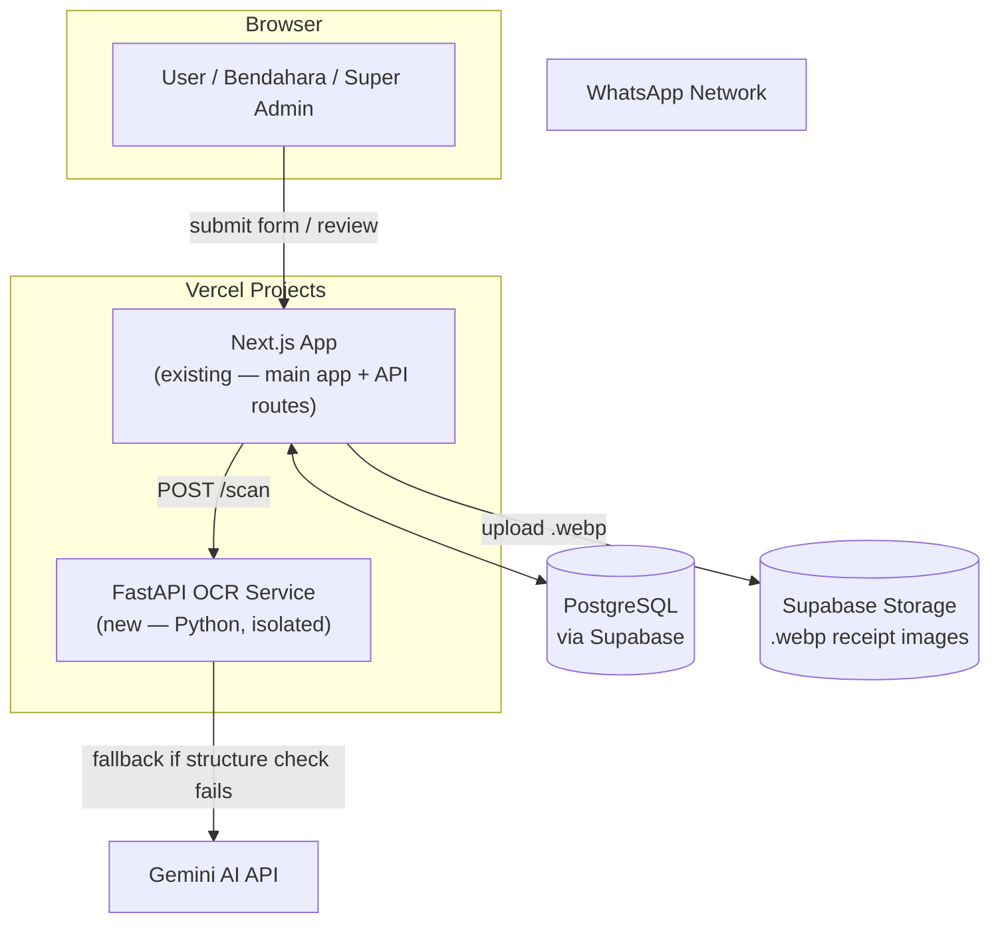
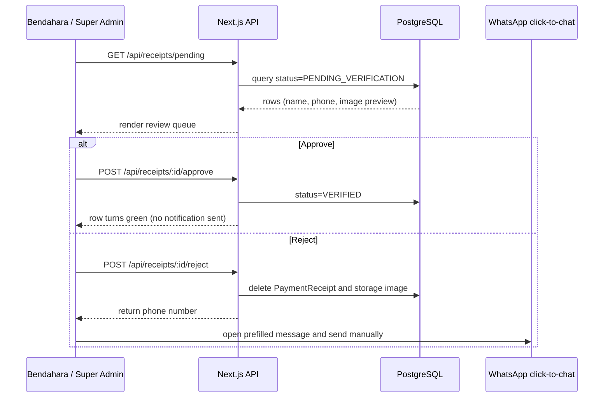

# ARCHITECTURE.md — Struk Scanner Feature

> **Current implementation note (14 Oktober 2026):** The implemented topology is Vercel + Supabase. WAHA and automatic WhatsApp delivery were removed; rejection uses manual click-to-chat.

## Entry Point (All Documents Start Here)

```
[User Input Full Name (dropdown)] + [User Input Phone/WA Number] + [User Input Receipt Image] → Submit
```

## 1. Service Topology

The current deployment uses two Vercel projects plus Supabase:



### Why OCR is a separate service (not a child process inside Next.js)

Decided after structured trade-off analysis (see brainstorming transcript, "Poin 2" council discussion). Summary of the reasoning:

- OCR + Gemini fallback is CPU/AI-bound work, fundamentally different in nature from Next.js's request-response web serving.
- Running it as an in-process child process (`child_process.exec`) would share Railway's resource limits (RAM/CPU billing) with the main app — a slow or crashing OCR call could degrade the public jersey registration pages.
- The OCR service is deployed separately so image processing cannot degrade the main Next.js request path.
- Recommendation was to keep the FastAPI service **minimal at first** (single `POST /scan` endpoint, no auth/queue complexity) rather than over-engineering it — isolation matters more than feature completeness at this stage.

## 2. End-to-End Data Flow

```mermaid
sequenceDiagram
    participant U as User
    participant N as Next.js API
    participant O as FastAPI OCR
    participant G as Gemini AI
    participant S as Supabase
    participant D as PostgreSQL

    U->>N: Submit (name, phone, receipt image)
    N->>N: normalize phone number
    alt phone valid
        N->>O: POST /scan (image)
        O->>O: OCR structure check
        alt OCR fails
            O->>G: fallback scan (handles handwritten/cash receipts)
        end
        O-->>N: { status, receiptHash }
        alt scan failed (OCR + Gemini both failed)
            N-->>U: 422 — ask for clearer photo (no DB write)
        else scan succeeded
            Note over N,D: receiptHash is stored for traceability; duplicate comparison is disabled
            N->>N: convert image to .webp
            N->>S: upload .webp
            N->>D: upsert PaymentReceipt (status=PENDING_VERIFICATION)
            N-->>U: success — row turns yellow
        end
    end
```

## 3. Bendahara Review Flow



## 4. Deployment Topology

| Service | Type | Notes |
|---|---|---|
| `pusakafc26` | Next.js app on Vercel | Public-facing + admin panel + API routes |
| `pusakafc26-ocr` | FastAPI on Vercel | Single `/scan` endpoint; stateless |

External managed services:
- **Supabase PostgreSQL** — database for registrant + payment data.
- **Supabase** — object storage for `.webp` receipt images.
- **Gemini AI API** — called only by the FastAPI OCR service, never directly by Next.js.

## 5. Isolation & Resource Rationale

- The FastAPI OCR service runs independently from the main app and remains stateless.
- Next.js is the single orchestrator: it is the only service that talks to the database and decides what gets persisted. OCR only processes images and returns scan metadata.

## 6. Known Constraints (carried over from brainstorming)

- Rejection has no server-side WhatsApp dependency; the reviewer sends the prefilled click-to-chat message manually.
- No automated amount verification exists anywhere in this pipeline; OCR/Gemini only confirm the receipt's structural validity, not its financial content. Final payment correctness is a human (Bendahara) judgment call.
- Scale is intentionally small (~250 users, seasonal usage) — this architecture is deliberately not over-built for high concurrency or long-term multi-tenant reuse.
